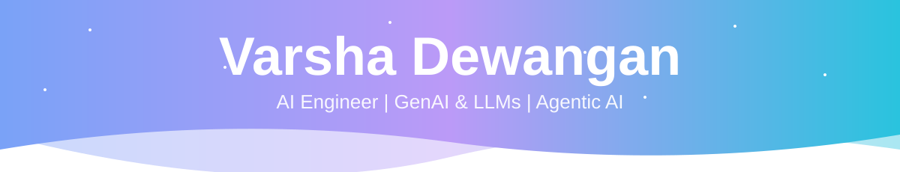
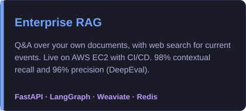
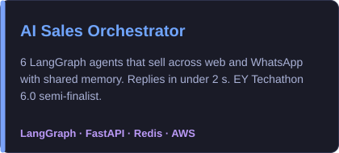
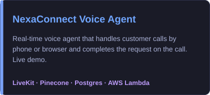
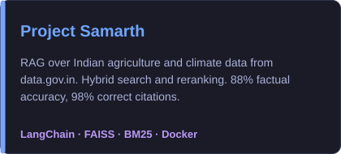
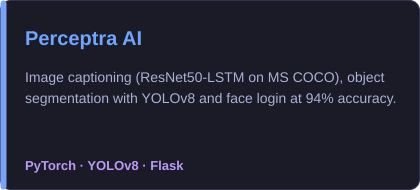
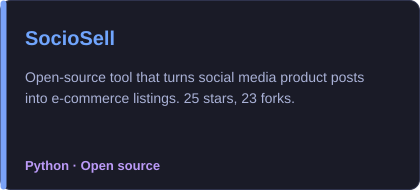

<div align="center">
  
</div>

<div align="center">
  
</div>

<p align="center">
  <a href="https://linkedin.com/in/varsha-dewangan-197983256">
    
  </a>
  <a href="mailto:varshadewangan1605@gmail.com">
    
  </a>
  <a href="https://codolio.com/in/varshadewangan454">
    
  </a>
  <a href="https://huggingface.co/Vara1605454">
    
  </a>
</p>

---

## 🎯 About Me

```python
class VarshaDewangan:
    def __init__(self):
        self.role = "AI Engineer"
        self.focus = ["Agentic AI", "GenAI", "LLMs", "RAG", "Voice Agents", "LangGraph"]
        self.education = "B.Tech CSE (AI & ML), Kalinga University — CGPA 9.1"
        self.open_to = ["AI Engineer roles", "Remote", "Hybrid", "On-site"]
```

- 🤖 I build RAG systems, multi-agent systems and real-time voice agents
- 🚀 I take projects past the demo: deployment, CI/CD, testing, retries and fallbacks
- 🧠 I also work on deep learning for medical imaging (3D CT scans)
- 💬 Ask me about RAG, LangGraph, voice agents or LLM evaluation

---

## 💼 Experience

**AI/ML Engineer Intern — Etech Global Services** · Remote · Jan 2026 – Aug 2026
- Delivered a multimodal RAG pipeline over text, tables and images in PDF and DOCX files, improving retrieval relevance by 40%
- Improved a grammar-correction engine from 40% to 90%+ accuracy
- Built a LangGraph speech-to-speech voice agent on Amazon Nova 2 Sonic with 700–800 ms end-to-end latency
- Implemented long-term memory for LLM agents with mem0

**Research Intern — IIT Ropar** · On-site · Jan 2026 – Jun 2026
- Designed a 6-step pipeline that turns 518 raw CTA scans into training-ready 3D patches for brain aneurysm detection
- Fixed a coordinate mismatch bug that had placed ~50% of positive patches at the wrong locations

**AI Model Trainer and Evaluator — Outlier** · Freelance · Oct 2024 – Jan 2026
- Evaluated and corrected LLM responses for math, logic and reasoning, used as training data

**Machine Learning Intern — PW (PhysicsWallah)** · Remote · Feb 2025 – Mar 2025
- Built a LightGBM revenue model on 900K+ e-commerce sessions and a Streamlit dashboard for traffic KPIs

---

## 🌟 Featured Projects

<table>
  <tr>
    <td width="50%" valign="top">
      <a href="https://github.com/Varsha-1605/Question-Answering-Chatbot">
        
      </a>
    </td>
    <td width="50%" valign="top">
      <a href="https://github.com/Varsha-1605/AI-Sales-Orchestrator">
        
      </a>
    </td>
  </tr>
  <tr>
    <td width="50%" valign="top">
      <a href="https://github.com/Varsha-1605/NexaConnect-Voice-Agent">
        
      </a>
      <p align="center"><a href="https://nexaconnect-web.pages.dev">▶ Live demo</a></p>
    </td>
    <td width="50%" valign="top">
      <a href="https://github.com/Varsha-1605/Project-Samarth">
        
      </a>
      <p align="center"><a href="https://vara1605454-project-samarth.hf.space/">▶ Live demo</a></p>
    </td>
  </tr>
  <tr>
    <td width="50%" valign="top">
      <a href="https://github.com/Varsha-1605/Image-Captioning-and-Segmentation">
        
      </a>
    </td>
    <td width="50%" valign="top">
      <a href="https://github.com/Varsha-1605/SocioSell">
        
      </a>
    </td>
  </tr>
</table>

---

## 🏅 Honors & Awards

<div align="center">
  <table>
    <tr>
      <td width="50%" align="center">
        <h3>🏆 EY Techathon 6.0 Semi-Finalist</h3>
        <p><kbd>Top 61 of 185,000+ registrations</kbd></p>
        <p>Built solo. Pitched to Aditya Birla Fashion & Retail.</p>
      </td>
      <td width="50%" align="center">
        <h3>🥈 Global AI Buildathon 2025</h3>
        <p><kbd>1st Runner-Up</kbd></p>
        <p>Girls Leading Tech. Built solo, 400+ teams worldwide.</p>
      </td>
    </tr>
    <tr>
      <td align="center">
        <h3>💡 Hack4Change 2024 Finalist</h3>
        <p><kbd>Top 0.7%</kbd></p>
        <p>Google & The Nudge Institute, 6,000+ participants.</p>
      </td>
      <td align="center">
        <h3>🎯 MATHack 2.0 Finalist</h3>
        <p><kbd>Top 35 of 10,000+</kbd></p>
        <p>Government of Telangana.</p>
      </td>
    </tr>
    <tr>
      <td align="center">
        <h3>🎓 100% Scholarship</h3>
        <p><kbd>Kalinga University</kbd></p>
        <p>Full 4-year B.Tech scholarship.</p>
      </td>
      <td align="center">
        <h3>🌟 Academic Excellence</h3>
        <p>
          
          
        </p>
        <p>CGBSE Board 2022. IBC24 Swarn Sharda Scholarship.</p>
      </td>
    </tr>
  </table>
</div>

---

<details open>
  <summary><h2>🛠️ Technologies & Tools</h2></summary>
  <div>
    

<h3>🤖 GenAI & Agents</h3>
<p>
  
  
  
  
  
  
  
</p>

<h3>🗄️ Vector Databases</h3>
<p>
  
  
  
</p>

<h3>☁️ Cloud & Deployment</h3>
<p>
  
  
  
</p>

<h3>🧠 ML & Data</h3>
<p>
  
  
  
  
</p>

<h3>💡 Areas</h3>
<p>Agentic AI · Multi-agent Systems · RAG · LLMs · Multimodal AI · Conversational AI · Prompt Engineering · Model Evaluation · NLP · Deep Learning · REST APIs · AI System Design</p>
  </div>
</details>

---

## 📊 GitHub Analytics

<div>
  
  <p align="center">
    
    
  </p>
</div>


---

## 🌱 Open Source

- **Project Admin, SWOC** — led SocioSell, reviewed and merged 25 pull requests from 7 contributors
- **GSSoC'24 Extended** — ranked 73rd of 42,000+ contributors with 22 merged pull requests
- **Hacktoberfest 2024** — contributor

<details>
  <summary><h3>🎉 Hacktoberfest 2024 Badges</h3></summary>
  <div align="center">
    <a href="https://holopin.io/@varsha1605">
      
    </a>
  </div>
</details>

---

<div align="center">
  
</div>


